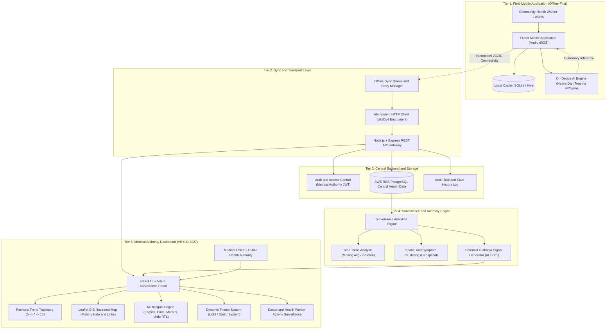

# GramCare 🏥

## AI-Powered Offline Disease Outbreak Monitoring System

> **Final Year Computer Engineering Project**
>
> GramCare is an offline-first healthcare monitoring platform designed for rural and low-connectivity communities. It allows health workers to record patient symptoms without continuous internet access, perform AI-assisted symptom classification on the device, synchronize records when connectivity returns, and analyze aggregated health data for time trends, geographic patterns, case clusters, and potential outbreak signals.

---

## 👥 Core Project Team

| Member | Role | Key Responsibilities | Core Skills |
|---|---|---|---|
| **M. Faizan Patel** | **Project Lead** | • **Product & Architecture:** Solution design and system architecture.<br>• **App Development:** Flutter app and offline-first workflow.<br>• **AI & Analytics:** Symptom classification and disease-pattern analysis.<br>• **Backend & Dashboard:** API, database, and dashboard development.<br>• **Research:** Feasibility, risk assessment, and validation. | Flutter • Python • Machine Learning • React • Node.js • PostgreSQL |
| **Niranjan Mohite** | **Research & Data Analyst** | • **Data Management:** Dataset preparation and data quality.<br>• **AI Support:** Model testing and performance evaluation.<br>• **Research & Documentation:** Literature review, testing, and project documentation.<br>• **Validation:** Evaluate system outputs using synthetic test data. | Python • Machine Learning • Data Analysis • Dataset Preparation • Model Testing • Research & Documentation |

```text
┌─────────────────────────────────────────────────────────────────────────────┐
│                              M. Faizan Patel                                │
│                               Project Lead                                  │
├─────────────────────────────────────────────────────────────────────────────┤
│  Role & Responsibilities                                                    │
│  • Product & Architecture: Solution design & system architecture            │
│  • App Development: Flutter app and offline-first workflow                  │
│  • AI & Analytics: Symptom classification and disease-pattern analysis      │
│  • Backend & Dashboard: API, database, and dashboard development            │
│  • Research: Feasibility, risk assessment, and validation                   │
│                                                                             │
│  Core Skills                                                                │
│  Flutter • Python • Machine Learning • React • Node.js • PostgreSQL         │
└─────────────────────────────────────────────────────────────────────────────┘

┌─────────────────────────────────────────────────────────────────────────────┐
│                              Niranjan Mohite                                │
│                          Research & Data Analyst                            │
├─────────────────────────────────────────────────────────────────────────────┤
│  Role & Responsibilities                                                    │
│  • Data Management: Dataset preparation and data quality                    │
│  • AI Support: Model testing and performance evaluation                     │
│  • Research & Documentation: Literature review, testing & documentation     │
│  • Validation: Evaluate system outputs using synthetic test data            │
│                                                                             │
│  Core Skills                                                                │
│  Python • Machine Learning • Data Analysis • Dataset Preparation • Testing  │
└─────────────────────────────────────────────────────────────────────────────┘
```

> **Hackathon Submission:** [**MY Bharat — Hack for a Social Cause**](https://mybharat.gov.in/pages/hack-for-social-cause)  
> **Initiative:** Vikasit Bharat Young Leaders Dialogue (VBYLD 2027)  
> **Focus Track:** Healthcare Technology, Low-Connectivity Surveillance, Rural Social Impact  
> **Repository:** [https://github.com/Faizan960/GramCare-AI-VBYLD-2027](https://github.com/Faizan960/GramCare-AI-VBYLD-2027)

---

## 📌 Project Overview

Rural and remote healthcare environments can face unreliable connectivity, fragmented patient records, delayed reporting, and limited visibility across nearby communities. A health worker may know that several patients in one village have similar symptoms, while having no easy way to compare that pattern with nearby villages.

GramCare is designed around a simple idea:

> **Turn field-level patient records into community-level health intelligence.**

The platform combines:

- **Offline-first healthcare data collection**
- **AI-assisted symptom classification**
- **Local data storage**
- **Automatic synchronization when connectivity returns**
- **Time-based disease trend analysis**
- **Geographic/location analysis**
- **Case-cluster identification**
- **Potential outbreak detection**
- **Interactive monitoring dashboard**
- **Alerts and reports for medical officers**

The goal is to support a shift from delayed, fragmented reporting toward more proactive, data-driven disease monitoring.

---

## 🎯 Problem Statement

GramCare is designed to address the following connected challenges in rural and low-connectivity healthcare:

1. **Poor Internet Connectivity**  
   Health workers may work in areas where continuous internet access is unavailable.

2. **Fragmented Health Records**  
   Patient data may be paper-based, isolated, or stored separately across locations.

3. **Delayed Disease Reporting**  
   Important changes in disease activity may only become visible after reporting delays.

4. **Limited Community-Level Visibility**  
   A local health worker may not see patterns developing across neighbouring villages.

5. **Manual Analysis**  
   Comparing case counts, symptoms, locations, and time trends manually can be slow.

6. **Difficulty Identifying Potential Clusters**  
   Similar cases occurring close together in time and location may not be obvious when records are viewed individually.

---

## 💡 Proposed Solution

GramCare proposes a mobile field application that remains usable without a network connection.

A health worker can:

1. Register or select a patient.
2. Record symptoms and basic health information.
3. Receive AI-assisted symptom analysis on the device.
4. Save the record locally when offline.
5. Continue working without waiting for connectivity.
6. Synchronize pending records when internet connectivity returns.

The central system then combines records from multiple locations and analyzes them for:

- **Time trends** — Is case activity increasing?
- **Location patterns** — Where are cases concentrated?
- **Case clusters** — Are similar conditions appearing repeatedly?

When the configured conditions indicate an unusual pattern, the system generates a **Potential Outbreak Alert** for medical officers or health authorities to investigate.

---

## 🔄 End-to-End Project Flow

```text
                         HEALTH WORKER
                              │
                              ▼
                    ┌──────────────────┐
                    │ Flutter Mobile   │
                    │ Application      │
                    └────────┬─────────┘
                             │
                   Patient Registration
                             +
                     Symptom Recording
                             │
                             ▼
                  ┌─────────────────────┐
                  │ On-Device AI        │
                  │ Symptom Analysis    │
                  └──────────┬──────────┘
                             │
                             ▼
                  ┌─────────────────────┐
                  │ Offline Storage     │
                  │ Hive / sqflite      │
                  └──────────┬──────────┘
                             │
                       Connectivity
                           Returns
                             │
                             ▼
                  ┌─────────────────────┐
                  │ Node.js + Express   │
                  │ Synchronization API │
                  └──────────┬──────────┘
                             │
                             ▼
                  ┌─────────────────────┐
                  │ AWS RDS PostgreSQL  │
                  │ Central Health Data │
                  └──────────┬──────────┘
                             │
                             ▼
               ┌──────────────────────────┐
               │ Disease Pattern Analysis │
               ├──────────────────────────┤
               │ • Time Trends            │
               │ • Location Patterns      │
               │ • Case Clusters          │
               └────────────┬─────────────┘
                            │
                            ▼
                  ┌─────────────────────┐
                  │ Potential Outbreak  │
                  │ Detection / Alerts  │
                  └──────────┬──────────┘
                             │
                             ▼
                  ┌─────────────────────┐
                  │ React Monitoring    │
                  │ Dashboard           │
                  │ + Recharts          │
                  │ + Leaflet           │
                  └──────────┬──────────┘
                             │
                             ▼
                  Medical Officers /
                  Health Authorities
```

### In one line

**Collect → Store Offline → Analyze → Synchronize → Detect Patterns → Visualize → Alert**

---

## 🏗️ System Architecture & Data Flow

GramCare AI employs an **offline-first, 5-tier architecture** designed to bridge remote rural health workers (ASHAs/ANMs) with public health administrators and medical officers, operating reliably even under zero-connectivity field conditions.



### End-to-End Architectural Tier Breakdown

```text
┌────────────────────────────────────────────────────────────────────────────────────────┐
│                               1. FIELD APPLICATION TIER                                │
│  • Flutter field app running on budget Android/iOS mobile devices.                     │
│  • Local persistence via Hive / sqflite (100% offline patient entry & history).        │
│  • Embedded Decision Tree/Random Forest compiled to native Dart via m2cgen.            │
│  • Zero remote API dependency during patient triage and clinical encounter entry.      │
└──────────────────────────────────────────┬─────────────────────────────────────────────┘
                                           │
                              Intermittent │ Connectivity (2G/3G/WiFi)
                                           ▼
┌────────────────────────────────────────────────────────────────────────────────────────┐
│                              2. SYNC & TRANSPORT LAYER                                 │
│  • Offline sync queue with automatic background detection when connectivity returns.   │
│  • Idempotent batch upload using client-generated UUIDv4 encounter keys.               │
│  • Strict status lifecycle: Pending (offline) -> Synced (central store).               │
│  • Resilient exponential backoff retry policy for poor-quality rural networks.         │
└──────────────────────────────────────────┬─────────────────────────────────────────────┘
                                           │
                               REST JSON   │ Payloads (/api/v1/sync)
                                           ▼
┌────────────────────────────────────────────────────────────────────────────────────────┐
│                             3. CENTRAL BACKEND & STORAGE                               │
│  • Node.js & Express REST microservices with rate limiting and CORS protection.        │
│  • AWS RDS PostgreSQL central normalized database with transactional migrations.       │
│  • Strict pseudonymity enforcement (GC-PXXXX IDs, zero real patient PII/addresses).    │
│  • Human review status tracking for medical officer oversight (FR-AU-05).              │
└──────────────────────────────────────────┬─────────────────────────────────────────────┘
                                           │
                                 Aggregated│ Queries & Geospatial Joins
                                           ▼
┌────────────────────────────────────────────────────────────────────────────────────────┐
│                       4. SURVEILLANCE & OUTBREAK ANALYTICS                             │
│  • 3-Dimensional Pattern Analysis: Time Trend + Spatial Proximity + Symptom Cluster.   │
│  • Statistical baseline comparison against historical thresholds (D-007).              │
│  • Cross-village correlation detection (e.g., Village C hotspot & Village D cluster).  │
│  • Decision-support evidence generation with contributing encounter references.        │
└──────────────────────────────────────────┬─────────────────────────────────────────────┘
                                           │
                                WebSocket /│ HTTP REST APIs
                                           ▼
┌────────────────────────────────────────────────────────────────────────────────────────┐
│                     5. MODERN SURVEILLANCE DASHBOARD (REACT 18)                        │
│  • Responsive React 18 + Vite 6 web application with Recharts & Leaflet GIS.          │
│  • 4-Language Localization: English (en), Hindi (hi), Marathi (mr), and Urdu (ur).    │
│  • Native Urdu Right-to-Left (RTL) layout with LTR protection for clinical IDs.        │
│  • Complete Light, Dark, and OS System-preference appearance theming.                  │
│  • Dedicated Doctor & Health Worker Activity tab (153 visits across 8 personnel).      │
│  • Detailed Clinical Encounter and Patient Longitudinal History modals.                │
└────────────────────────────────────────────────────────────────────────────────────────┘
```

---

## 🧰 Technology Stack

| Layer | Technology | Role |
|---|---|---|
| Field Mobile App | **Flutter** | Health-worker mobile application; single codebase for Android + iOS |
| Local Offline Storage | **Hive / sqflite** | Stores records on-device when offline |
| AI Training | **Python + scikit-learn** | Train lightweight symptom-classification model |
| Model Deployment | **m2cgen → Dart** | Convert the selected tree model into native Dart code |
| ML Model | **Decision Tree / Small Random Forest** | Symptom → possible condition classification |
| Backend / Sync API | **Node.js + Express** | Receives queued records and serves dashboard APIs |
| Central Database | **AWS RDS PostgreSQL** | Central source of truth for patient/case data |
| Dashboard | **React** | Online monitoring interface |
| Charts | **Recharts** | Trends and analytical visualizations |
| Maps | **Leaflet** | Village/location visualization |
| File Storage | **AWS S3** | Model artifacts and exported reports only |
| Outbreak Detection | **Node.js + PostgreSQL queries/statistical logic** | Time + location + cluster pattern analysis |
| Training Environment | **SageMaker Studio Lab / local machine** | Training lightweight ML models |

### Explicitly deferred

**Neo4j / graph database is not required for the MVP.** PostgreSQL relationships are considered sufficient unless later evaluation demonstrates a clear benefit from graph-based analysis.

---

## 🤖 AI / ML Methodology

### Patient-Level AI

The primary AI task is **symptom classification**.

```text
Reported Symptoms
        ↓
AI-Assisted Symptom Analysis
        ↓
Possible Condition
        ↓
Confidence / Reasoning
```

### Current model direction

The planned model is a **Decision Tree or small Random Forest (~10–20 trees)**.

Why:

- Symptom data is expected to be structured/tabular.
- Training is lightweight.
- Inference requires little computational power.
- Tree-based reasoning is easier to explain in an engineering viva.
- The model can be converted into native Dart code for on-device inference.

### Deployment path

```text
Public Dataset
      ↓
Python / scikit-learn
      ↓
Train + Evaluate
      ↓
Selected Tree Model
      ↓
m2cgen
      ↓
Native Dart Code
      ↓
Flutter App
      ↓
Offline On-Device Inference
```

No TFLite runtime is required by the current chosen path.

An alternative small neural-network/TFLite route may be reconsidered only if implementation or reporting requirements justify it.

---

## 🚨 Potential Outbreak Detection

GramCare does **not** try to prove that an outbreak has occurred.

It identifies a combination of signals that may indicate a pattern worth investigating.

### Three analysis dimensions

#### 1. Time Trends

Measure case counts over time to identify unusual increases.

#### 2. Location Patterns

Group cases by village/area to identify geographic concentration.

#### 3. Case Clusters

Group cases by condition and identify repeated or concentrated patterns.

### Alert concept

A Potential Outbreak Alert is generated when the relevant dimensions intersect, for example:

```text
Same Condition
      +
Same / Nearby Location
      +
Increasing Case Count
      +
Short Time Window
      ↓
Potential Outbreak Pattern
      ↓
Potential Outbreak Alert
```

The MVP intentionally prefers an **explainable threshold/anomaly approach** over a complex epidemiological deep-learning model.

The final baseline and threshold values will be tuned against the synthetic demonstration dataset and recorded in the project's decision log.

---

## 🗃️ High-Level Data Model

### Patients

```text
patients
- id
- age
- gender
- village_id
- created_at
```

### Villages

```text
villages
- id
- name
- region
- lat
- lng
```

### Visits / Health Records

```text
visits / health_records
- id
- patient_id
- visit_date
- symptoms[]
- predicted_condition
- confidence
- sync_status
```

### Case Aggregates

```text
case_aggregates
- village_id
- week
- condition
- case_count
```

### Supporting entities

```text
health_workers
symptoms
sync_logs
alerts
reports
```

The exact production schema will be finalized during implementation.

---

## 📱 Offline-First Operation

Offline functionality is a core requirement.

### When there is no internet

```text
Health Worker
     ↓
Flutter App
     ↓
Local Storage
     ↓
Record saved
     ↓
sync_status = PENDING
```

The worker can continue collecting records.

### When internet returns

```text
Pending Local Records
        ↓
Node.js + Express Sync API
        ↓
AWS RDS PostgreSQL
        ↓
sync_status = SYNCED
```

The exact conflict-resolution strategy will be finalized during implementation.

---

## 📊 Dashboard Plan

The dashboard is intended for medical officers and health authorities and is designed to be online because it consumes centrally synchronized data.

### Dashboard sections

- **Overview** — total cases, active alerts, affected villages
- **Disease Trends** — weekly/time-based trends
- **Location View** — village-level case distribution
- **Map View** — potential hotspots
- **Case Clusters** — condition distribution / concentrated patterns
- **Alerts** — potential outbreak alerts with reasoning
- **Reports** — summaries and exports

---

## 👩‍⚕️ User Roles

### Health Worker

- Register patients
- Record symptoms
- View relevant patient records
- Work offline
- Receive AI-assisted symptom analysis
- Synchronize records

### Medical Officer / Health Authority

- Monitor aggregated data
- View disease trends
- View geographic patterns
- Review potential outbreak alerts
- Review reports and insights
- Make the final medical/public-health decisions

---

## 🧪 Demo Plan

The college demonstration will use **synthetic / fictional data only**.

### Demo scenario

1. Put the Flutter field app into offline mode.
2. Register several fictional patients.
3. Record symptoms.
4. Show on-device AI producing a possible condition and confidence.
5. Show records stored locally.
6. Reconnect the device.
7. Synchronize pending records to the backend/database.
8. Open the React dashboard.
9. Show synchronized data appearing in analytics.
10. Simulate an increase in similar cases in a village.
11. Demonstrate time trend, location concentration, and case cluster.
12. Generate a **Potential Outbreak Alert**.
13. Show the affected location on the map.
14. Show the medical officer reviewing the alert and supporting reasoning.

### Example synthetic scenario

```text
Village A → Normal
Village B → Sudden increase
Village C → Similar cases
Village D → Normal
```

A representative test case can include **11 similar cases in Village B within a short period** to exercise the alert logic.

This is a simulated demonstration scenario and is **not evidence of real-world outbreak prediction**.

---

## 📅 Development Roadmap — 16 Weeks

| Weeks | Phase | Main Output |
|---|---|---|
| 1–2 | Requirements + Architecture | Final requirements, architecture and decisions |
| 3–4 | Data Model + Flutter Skeleton | Database schema and working mobile foundation |
| 5–6 | Symptom AI | Trained model + Dart integration |
| 7–8 | Synchronization | Flutter ↔ Node sync + status handling |
| 9–10 | Central Analysis | Aggregates + outbreak logic |
| 11–12 | Dashboard | React + Recharts + Leaflet |
| 13 | Testing | Unit + integration + offline tests |
| 14 | Synthetic Data + Demo | 50–100 fictional records / scenario |
| 15–16 | Documentation + Polish | Final integration and presentation readiness |

### Development philosophy

> **Simple → Working → Testable → Explainable → Extendable**

The project prioritizes a complete, defendable MVP over unnecessary technical complexity.

---

## 🗓️ Week-Wise Implementation Plan

### Week 1
Requirements finalization and project setup.

### Week 2
Architecture, data-flow, database and local-storage design.

### Week 3
Flutter application foundation and navigation.

### Week 4
Patient registration and health-record interfaces.

### Week 5
Prepare public symptom/disease dataset and baseline ML model.

### Week 6
Evaluate the model, convert the selected model to Dart and integrate on-device inference.

### Week 7
Implement local record queueing and synchronization workflow.

### Week 8
Node.js + Express sync endpoints and error/status handling.

### Week 9
Central data aggregation and analytical queries.

### Week 10
Potential outbreak detection and alert generation.

### Week 11
React dashboard foundation and API integration.

### Week 12
Charts, location views, alerts and reports.

### Week 13
Functional, AI, offline, synchronization and integration testing.

### Week 14
Populate synthetic demonstration data and rehearse end-to-end scenario.

### Week 15
Fix issues, improve UI/UX and complete documentation.

### Week 16
Final integration, presentation preparation and buffer.

---

## 🖥️ Hardware & Software Requirements

### Development Hardware

- Laptop/Desktop
- Minimum **8 GB RAM**
- Recommended **16 GB RAM**
- Sufficient storage for Flutter/Node/React development and datasets

### Field Device

- Android/iOS smartphone
- Local storage
- Optional GPS/location capability
- Network access when synchronization is required

### Software

- Flutter / Dart
- Python / scikit-learn / m2cgen
- Node.js / Express
- React
- Recharts
- Leaflet
- AWS RDS PostgreSQL
- AWS S3
- Git

---

## 🔐 Privacy, Security & Medical Boundaries

GramCare is a **prototype decision-support system**.

It does not:

- Replace doctors
- Provide definitive clinical diagnosis
- Automatically confirm outbreaks
- Make autonomous medical decisions

It provides:

- AI-assisted analysis
- Possible-condition predictions
- Disease-pattern insights
- Potential outbreak alerts
- Decision-support information

### Data policy

- Use synthetic/demo patient data for demonstrations.
- Do not use real patient information without an appropriate approved process.
- Avoid storing patient records in object/file storage.
- Protect credentials and secrets.
- Apply appropriate access control in the implemented system.

---

## 📚 Research Foundation

The current literature foundation contains **8 verified IEEE papers** spanning:

- Disease prediction
- Symptom classification
- Spatio-temporal outbreak detection
- Mobile and rural healthcare
- Offline healthcare
- Graph-based healthcare
- Edge/mobile AI

The research gap is framed as an **integration gap**, not the invention of a new underlying algorithm.

### Core research gap

> Existing work demonstrates disease prediction, outbreak detection, graph-based healthcare, and mobile/offline healthcare as individual capabilities, but the reviewed literature shows limited integration of offline-first rural field data collection with AI-assisted symptom analysis and temporal/geographic community-level disease monitoring in one end-to-end system.

The project therefore focuses on integrating these components into a practical rural healthcare workflow.

---

## 📖 Selected IEEE References

1. Hossain, Islam, Islam, Shatabda, Ahmed — **Symptom Based Explainable AI Model for Leukemia Detection**, IEEE Access, 2022. DOI: `10.1109/ACCESS.2022.3176274`
2. Chittora, Chaurasia, Chakrabarti, et al. — **Prediction of Chronic Kidney Disease – A Machine Learning Perspective**, IEEE Access, 2021. DOI: `10.1109/ACCESS.2021.3053763`
3. Karadayi, Aydin, Öğrenci — **Unsupervised Anomaly Detection in Multivariate Spatio-Temporal Data... Early Detection of COVID-19 Outbreak in Italy**, IEEE Access, 2020. DOI: `10.1109/ACCESS.2020.3022366`
4. Khatun, Yousuf, Ahmed, Uddin, et al. — **Deep CNN-LSTM with Self-Attention for Human Activity Recognition Using Wearable Sensor**, IEEE JTEHM, 2022. DOI: `10.1109/JTEHM.2022.3177710`
5. Xuqing Chai — **Diagnosis Method of Thyroid Disease Combining Knowledge Graph and Deep Learning**, IEEE Access, 2020. DOI: `10.1109/ACCESS.2020.3016676`
6. Sun, Yin, Chen, Chen, Cui, Yang — **Disease Prediction via Graph Neural Networks**, IEEE Journal of Biomedical and Health Informatics, 2021. DOI: `10.1109/JBHI.2020.3004143`
7. Dasgupta, Ghosh, Mitra — **A Mobile Volunteered Geographic Information Management Platform for Rural Health Informatics**, IEEE HealthCom, 2015. DOI: `10.1109/HealthCom.2015.7454530`
8. Garces, Lojo — **Developing an Offline Mobile Application with Health Condition Care and First Aid Instruction for Appropriateness of Medical Treatment**, IEEE ISEC, 2019. DOI: `10.1109/ISECon.2019.8882013`

> The full literature review should be maintained in `Documentation/LITERATURE_REVIEW.md`, including access status and paper-level analysis.

---

## 📂 Repository Structure

```text
GramCare-Ai/
│
├── README.md
├── Documentation/
│   ├── PROJECT_OVERVIEW.md
│   ├── MVP_SCOPE.md
│   ├── ARCHITECTURE.md
│   ├── AI_REQUIREMENTS.md
│   ├── AI_METHODOLOGY.md
│   ├── DATASET_STRATEGY.md
│   ├── DATA_MODEL.md
│   ├── REQUIREMENTS.md
│   ├── DEMO_SCENARIO.md
│   ├── TESTING_STRATEGY.md
│   ├── DECISIONS.md
│   ├── LITERATURE_REVIEW.md
│   └── REVIEW2_RECONCILIATION.md
│
├── app/              # Flutter field application
├── backend/          # Node.js + Express backend
├── dashboard/        # React monitoring dashboard
├── ai/               # ML training / conversion assets
├── data/             # Development/demo datasets
└── tests/            # Automated and integration tests
```

The exact codebase layout may evolve as implementation begins.

---

## 🧭 Current Project Status

### Finalized

- Project name and core purpose
- Rural / low-connectivity target context
- Offline-first field application
- Flutter mobile application
- Local offline storage
- On-device AI direction
- Decision Tree / small Random Forest model direction
- scikit-learn → m2cgen → Dart deployment path
- Node.js + Express backend
- AWS RDS PostgreSQL central database
- React dashboard
- Recharts and Leaflet
- S3 limited to model artifacts and exports
- Time/location/case-cluster analysis
- Potential outbreak alerts
- Synthetic demo data
- 16-week development plan

### Deferred / subject to implementation validation

- Hive vs sqflite final selection
- Decision Tree vs Random Forest final choice
- Exact public training dataset
- Exact database schema details
- Synchronization conflict-resolution strategy
- Baseline and threshold values
- Detailed alert-severity rules
- Whether graph analysis adds enough value to justify future adoption

---

## 🚫 What GramCare Is Not

GramCare is not intended to be:

- A national healthcare platform
- A hospital management system
- A telemedicine platform
- A replacement for clinicians
- A definitive medical diagnosis engine
- An automatic outbreak confirmation system
- A mandatory graph-database project
- An LLM/RAG/AI-agent system

The project is intentionally scoped to a practical, explainable final-year engineering prototype.

---

## 🔮 Future Scope

Potential future enhancements include:

- More disease categories
- Broader and better training datasets
- Improved symptom models
- Advanced epidemiological forecasting
- Multilingual support
- Vaccination monitoring
- Telemedicine integration
- Wearable-device data
- Government/public-health system integration
- Larger regional deployments
- Advanced graph analytics where justified
- Improved synchronization for large numbers of field workers

These are future directions and are not automatically part of the current MVP.

---

## 🧪 Testing Goals

The final prototype should demonstrate:

### Functional
- Patient registration works offline.
- Symptoms can be recorded offline.
- Records persist locally.
- Records synchronize when connectivity returns.
- Dashboard receives synchronized data.
- Alerts can be generated.

### AI
- Model can classify selected symptoms.
- Evaluation uses a held-out dataset.
- Appropriate metrics such as accuracy, precision, recall and F1-score are reported where applicable.
- Results are never fabricated.

### Outbreak Logic
- Normal synthetic data does not trigger an inappropriate alert.
- Configured simulated abnormal patterns produce the intended potential alert.
- Alert reasoning is visible and understandable.

### Integration

```text
Offline Collection
       ↓
AI Analysis
       ↓
Local Save
       ↓
Connectivity Returns
       ↓
Synchronization
       ↓
Central Database
       ↓
Pattern Analysis
       ↓
Dashboard
       ↓
Potential Outbreak Alert
```

---

## ⚠️ Important Development Rules

1. **Do not over-engineer the MVP.**
2. **Do not add technologies just because they sound advanced.**
3. **Keep offline operation reliable.**
4. **Keep AI explainable and lightweight.**
5. **Do not claim diagnosis or confirmed outbreaks.**
6. **Use synthetic data for the application demo.**
7. **Keep public training data separate from demo data.**
8. **Never fabricate research papers, datasets, metrics or results.**
9. **Record major architectural decisions in `Documentation/DECISIONS.md`.**
10. **Keep documentation, diagrams, implementation and presentations consistent.**

---

## 📄 Documentation

The `Documentation/` directory is the project knowledge base and should be treated as the source of truth for requirements, architecture, AI constraints, research, decisions and scope.

Start with:

- `PROJECT_OVERVIEW.md`
- `MVP_SCOPE.md`
- `ARCHITECTURE.md`
- `AI_REQUIREMENTS.md`
- `REQUIREMENTS.md`
- `DATA_MODEL.md`
- `AI_METHODOLOGY.md`
- `DATASET_STRATEGY.md`
- `DEMO_SCENARIO.md`
- `TESTING_STRATEGY.md`
- `DECISIONS.md`
- `LITERATURE_REVIEW.md`

---

## 📜 Project Principle

> **Build a simple system that works completely, can be tested properly, can be explained in a viva, and can be extended later.**

---

## License

This repository is an academic Final Year Engineering Project. Add an appropriate license before public/open-source distribution.
